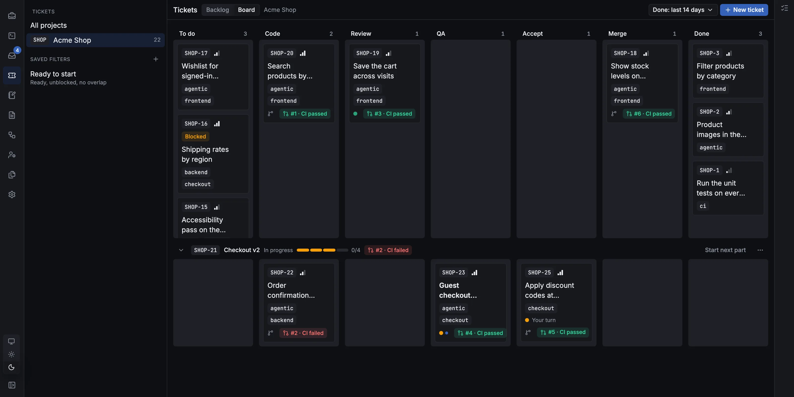

# PDT (Personal Dev Team)

A dev team that lives on your machine. PDT is a command center for building software with AI coding agents: a
backlog and board of tickets, Claude Code, Codex, Devin and other agents working on them in their own git worktrees,
review and merge, and terminals that keep running when you close the browser. It runs as a small server on your
machine, and the same web UI works from your phone or another computer over Tailscale.



- **Tickets and a pipeline.** Start a ticket and PDT makes its branch and worktree and puts an agent on it; workflows
  hand the work on to review and QA, and ask you at the points you choose.
- **Agents in terminals or as a chat**, on your own subscriptions. Sessions outlive the browser and PDT's restarts.
- **Review and merge**: a branch's diff with line comments sent back to the agent, then merge through the pull
  request (and its merge queue) or locally.
- **Run any branch** on its own port with one click, to try what an agent built.
- **Updates itself**, and rolls back when an update goes wrong.

## Install

macOS, Linux and Windows:

```sh
curl -fsSL https://pdt.dev/install.sh | sh        # macOS, Linux
irm https://pdt.dev/install.ps1 | iex             # Windows (PowerShell)
```

Then open http://127.0.0.1:7420. The [install guide](docs/user/getting-started/install.md) has the options and how to
install by hand; [Getting started](docs/user/getting-started/what-is-pdt.md) takes you from there to a first merged
ticket.

## Docs

- [User docs](docs/user/getting-started/what-is-pdt.md), also published on the website (built from `site/`).
- [Developer guide](docs/dev/architecture.md): how PDT is built, the invariants, testing.
- [How we work](docs/SDLC.md): branches, checks, CI, releases.

## Contributing

Bugs and ideas: open an issue (or use **Report a bug…** in PDT). Security problems: see [SECURITY.md](SECURITY.md),
never a public issue. To work on PDT, start with [CONTRIBUTING.md](CONTRIBUTING.md): what to install, how to make a
change and open a pull request, and how to try your branch. A dev build, on its own port and data folder:

```sh
pnpm install --frozen-lockfile
pnpm --dir web build
PDT_PROFILE=dev PDT_PORT=7421 PDT_DATA_DIR=/tmp/pdt-try PDT_SEED=demo PDT_WEB_DIR=$PWD/web/dist cargo run -p pdtd
# http://127.0.0.1:7421, with demo data
```

Run `scripts/check.sh` before you push: it runs what CI runs.

## License

PDT is licensed under the [Apache License, Version 2.0](LICENSE). See [NOTICE](NOTICE) for attribution, including
the bundled fonts.
